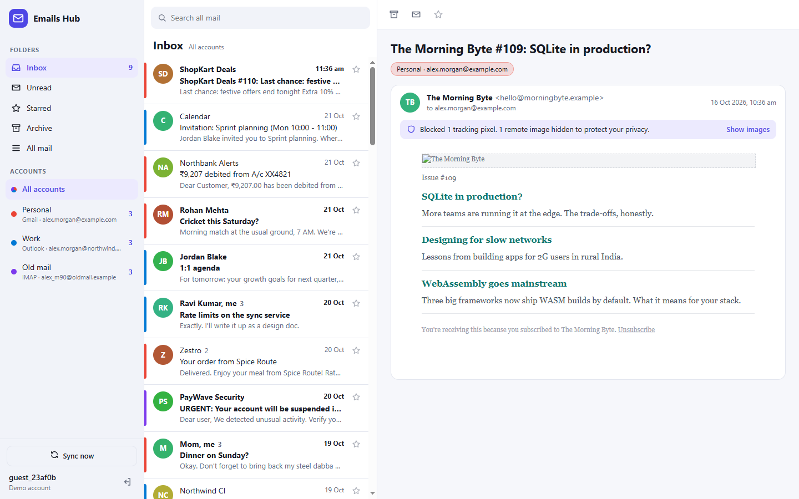
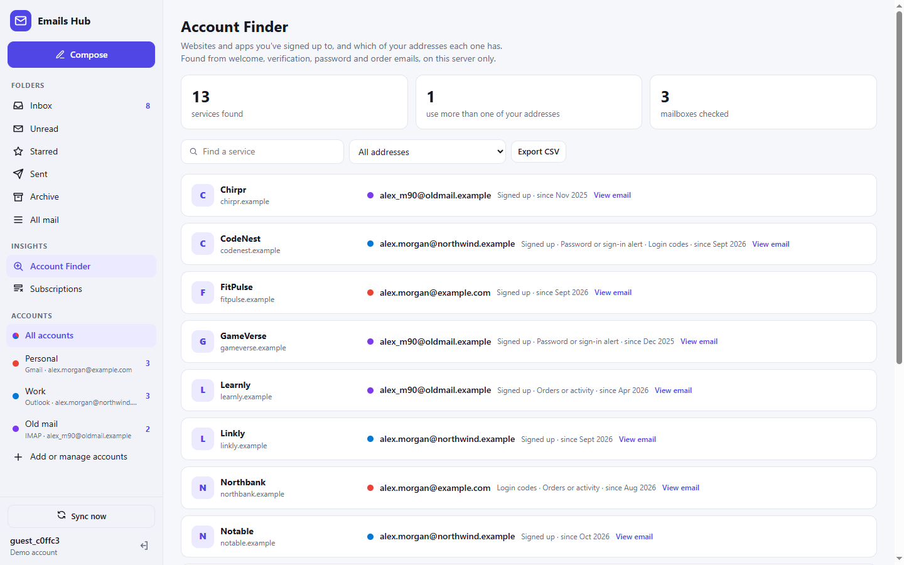
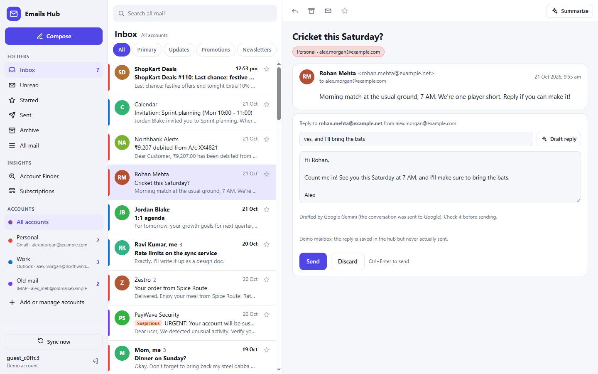
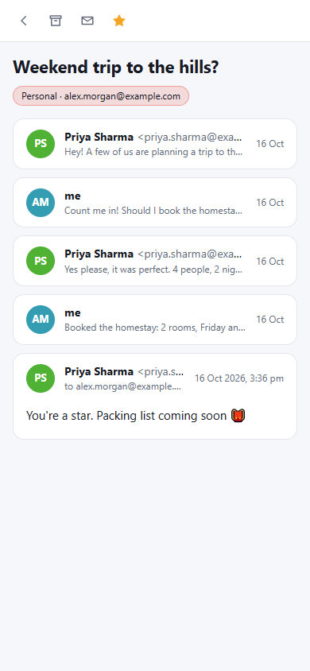

# Unified Emails Hub

[](https://github.com/kanujangid73-sudo/unified-emails-hub/actions/workflows/ci.yml)

**One fast, private inbox for every email account you own.** Gmail, Outlook and any IMAP
mailbox in a single list, newest first, colour-coded by account.



Most people juggle several addresses: a personal Gmail, a work Outlook, an old Yahoo from
college. Each needs its own app and login, and important mail gets lost between them. This
project brings them together behind one clean interface, and is built the way production
mail clients are: provider adapters, incremental sync, and untrusted email content treated
as untrusted.

## Try it

Press **Try the demo** on the sign-in screen. You get a temporary account with three sample
mailboxes (Personal Gmail, Work Outlook, an old IMAP account) holding about 170 realistic
messages. A few more arrive a couple of minutes later, showing incremental sync at work.
Every company and person in the demo is fictional.

## Features

- **Connect real mailboxes.** Gmail and Outlook with "Sign in with Google/Microsoft" (OAuth 2.0
  with PKCE), and any other provider (Yahoo, iCloud, Zoho, company servers) over IMAP and SMTP.
  Passwords and tokens are stored encrypted. See [docs/CONNECT_ACCOUNTS.md](docs/CONNECT_ACCOUNTS.md).
- **Unified inbox.** Conversations from every account in one list, each with its account's
  colour. Filter by account or by folder: Inbox, Unread, Starred, Sent, Archive, All mail.
- **Threaded conversations.** Replies are grouped; older read messages fold away, as in Gmail.
- **Read, star, archive.** Changes appear instantly (optimistic UI), are written to the real
  mailbox first, and roll back if the provider refuses.
- **Compose and reply** from any account. Replies are threaded correctly for every
  recipient's mail client (In-Reply-To and References headers).
- **Attachments**: see and download the files in any message, and attach up to 10 MB when
  writing. Files stay with the provider and are fetched only when you download them.
- **Search** across every account at once, with Gmail-style operators: `from:`, `to:`,
  `is:unread`, `is:starred`, `has:attachment`, `before:`, `after:`, `"exact words"`. Postgres full-text search
  with prefix matching in production.
- **Background sync.** The server keeps every account up to date even when nobody has the app
  open: incremental, retried with exponential backoff, and paused with a "Reconnect" prompt if
  a provider revokes access.
- **Privacy protection.** HTML email is sanitized and sandboxed; remote images are blocked until
  you choose to load them, and tracking pixels are always removed.
- **Account Finder.** Lists every website and app you've signed up to, and which of your
  addresses each one has, from welcome, verification, password-reset and order emails across
  all your mailboxes. Spot the forgotten accounts you should delete; export the list as CSV.
- **Phishing warnings** that explain themselves: look-alike sender domains, pressure tactics,
  unencrypted links.
- **Inbox tabs**: Primary, Updates, Promotions, Newsletters, sorted automatically.
- **Subscriptions**: every newsletter and promotion sender, how many you actually open, a
  one-click unsubscribe link and "archive all".
- **AI assistant** (Google Gemini, free tier): a one-line summary with to-dos for any
  conversation, and reply drafts you can steer ("say yes, I'll bring the bats"). Runs only when
  you click; without an API key the app falls back to built-in summaries and templates.
- **Keyboard shortcuts:** `j`/`k` next and previous, `r` reply, `c` compose, `e` archive,
  `s` star, `u` mark unread, `/` search, `Esc` close.
- **Works on phones.** One pane at a time on small screens.







## How it works

```
┌──────────────┐  REST + JWT  ┌─────────────────────────────────────────┐
│  React SPA   │ ───────────▶ │ FastAPI                                 │
│  (Vite)      │ ◀─────────── │                                         │
└──────────────┘              │  routers ──┐                            │      OAuth 2.0
                              │            ├─▶ sync engine ─▶ adapters ─┼──▶ Gmail API
                              │  scheduler ┘        │                   ├──▶ Microsoft Graph
                              │  (leases, backoff)  ▼                   ├──▶ IMAP / SMTP servers
                              │       Postgres (full-text search)       ├──▶ Demo mailboxes
                              │       encrypted credentials             │
                              └─────────────────────────────────────────┘
```

**Provider adapters.** Each mail service has an adapter implementing one small interface
([providers/base.py](backend/app/providers/base.py)): `fetch_changes(cursor)` returns new or
changed messages plus a cursor for next time, and `update_flags()` writes changes back. The rest
of the app never knows which provider a mailbox lives on.

**Sync engine** ([sync.py](backend/app/sync.py)), the core of the project:

1. Load the account's saved cursor (Gmail history id, Graph delta link, IMAP UID...).
2. Ask the adapter for changes since that cursor, one page at a time.
3. Upsert each page by the provider's own message ids. Running the same page twice updates
   rows instead of duplicating them.
4. Recompute the affected threads (latest date, preview, unread count, participants).
5. Commit the page **together with** the new cursor, so a crash or rate limit loses at most one
   page and the next sync resumes from there.

**Background scheduler** ([scheduler.py](backend/app/scheduler.py)): every 30 seconds it claims
accounts that are due with a conditional `UPDATE` (a lease), so several server instances never
sync the same account at once, then syncs them. Failures back off exponentially.

**Inbox queries** use keyset pagination on an index of `(user, archived, date, id)`, so pages
stay correct while new mail arrives and page 50 is as fast as page 1.

**Insights without sending mail anywhere** ([insights.py](backend/app/insights.py)): categories,
phishing warnings, the Account Finder and subscriptions are transparent rules run on the server
as mail syncs, so every result can be explained and nothing leaves the server. The AI is used
only on request, with the email text fenced off as untrusted data so a message can't give the
assistant instructions ([ai.py](backend/app/ai.py)).

**Rendering email safely**: DOMPurify, then a sandboxed iframe with no script permission, then
a Content-Security-Policy that blocks all network requests except images you chose to load.

The reasoning behind each choice is in [docs/DECISIONS.md](docs/DECISIONS.md).

## Performance

Measured with [`scripts/benchmark.py`](backend/scripts/benchmark.py), which runs the real sync
engine and API queries on a synthetic mailbox. CI runs it on Postgres 17 on every push (GitHub
Actions runner); the second column is SQLite on a laptop (i5-7300U, 8 GB RAM):

| Operation | Postgres, 20,000 messages | SQLite, 10,000 messages |
|---|---|---|
| Full first sync | 19.6 s (1,019 messages/s) | 15.6 s (640 messages/s) |
| Incremental sync, 50 new messages | 84 ms | 124 ms |
| Inbox, first page of 50 | p50 1.7 ms | p50 4.1 ms |
| All mail, page 41 (keyset pagination) | p50 2.3 ms | p50 3.9 ms |
| Full-text search "invoice payment" | p50 2.3 ms | p50 5.2 ms |
| Search with operators `from:person7 is:unread` | p50 4.8 ms | p50 11.2 ms |

The benchmark paid for itself: it showed that lists without the archive filter (All mail, Sent,
search) sorted every conversation, so deep pages were 5× slower than the first one. One
index (`user_id, last_message_at, id`) brought them to the same speed and made search
about 20× faster (measured on SQLite: 81 ms to 3.9 ms).

## Tech stack

| Layer | Tools |
|---|---|
| Frontend | React 18, Vite, DOMPurify, plain CSS (light and dark themes) |
| Backend | Python, FastAPI, SQLModel / SQLAlchemy 2, Alembic, httpx, imaplib/smtplib, JWT auth with PBKDF2 password hashing |
| Integrations | Gmail API, Microsoft Graph (delta queries), IMAP/SMTP; OAuth 2.0 with PKCE |
| AI | Google Gemini (structured JSON output, retries, graceful offline fallback) |
| Security | Fernet encryption with key rotation, DOMPurify + sandboxed iframes + CSP, SSRF guard, rate limits |
| Database | Postgres with full-text search (tsvector + GIN) in production, SQLite for development |
| Testing | 122 Pytest tests against fake Gmail, Graph, IMAP and Gemini servers (run on SQLite and Postgres), 18 Vitest tests |
| CI | GitHub Actions on every push |

## Run it locally

You need Python 3.11+ and Node 20+.

```bash
# Backend: http://localhost:8000 (API docs at /docs)
cd backend
python -m venv .venv
.venv\Scripts\activate          # macOS/Linux: source .venv/bin/activate
pip install -r requirements-dev.txt
uvicorn app.main:app --reload

# Frontend: http://localhost:5173 (in a second terminal)
cd frontend
npm install
npm run dev
```

Copy `backend/.env.example` to `backend/.env` and set `SECRET_KEY` and `ENCRYPTION_KEY`.
The demo needs nothing else; to connect real accounts, follow
[docs/CONNECT_ACCOUNTS.md](docs/CONNECT_ACCOUNTS.md).

Run the tests with `pytest` in `backend/` and `npm test` in `frontend/`.

To put it online for free (Render + Neon), follow [docs/DEPLOY.md](docs/DEPLOY.md).

## Roadmap

- [x] **Phase 1: Foundation.** Provider interface, sync engine, unified inbox, threads, flags,
      search, one-click demo, secure email rendering, tests and CI.
- [x] **Phase 2: Real accounts.** Gmail (OAuth 2.0 + history API), Outlook (Microsoft Graph +
      delta queries) and IMAP adapters; encrypted credentials; server-side scheduled sync with
      leases and backoff; Postgres full-text search with operators; compose and reply.
- [x] **Phase 3: Insights and AI.** Inbox categories, phishing warnings, Account Finder,
      subscription cleanup, AI summaries and reply drafts.
- [x] **Attachments** for every provider: list, download on demand, send.
- [ ] **Phase 4: Launch.** ~~Render Blueprint~~, ~~benchmarks~~, ~~CI auto-deploy~~; live
      deployment and [demo video](docs/DEMO_SCRIPT.md) to go.
